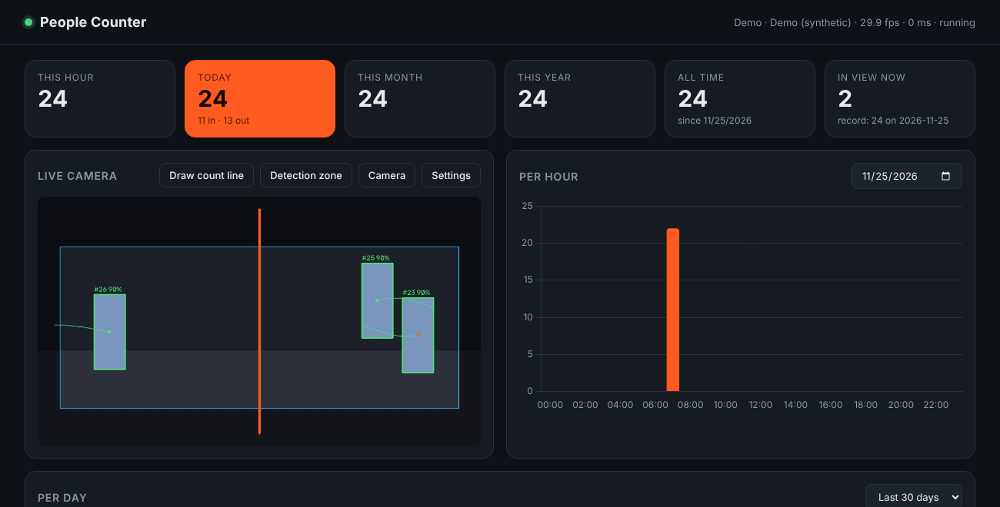

# Coral People Counter

[](https://github.com/p1e2r/coral-people-counter/actions/workflows/test.yml) [](https://github.com/p1e2r/coral-people-counter/actions/workflows/docker.yml)

Counts people walking past a camera using a **Google Coral USB Accelerator**, stores every count in SQLite, and serves a web dashboard with:

- Live camera view with detection boxes, track IDs and the counting line
- Totals for **this hour, today (in/out), this month, this year, all time**, plus people in view right now
- Bar charts **per hour** (any date), **per day** (last 30 days or any month), **per month** (any year), **per year**, and a busiest-hours profile
- Draw the counting line by clicking on the live image
- CSV export, optional admin token, and automatic reconnect for USB and RTSP cameras

A person is counted when their track crosses the line (`line` mode, counted as in or out) or the first time they are confirmed (`unique` mode). If no Coral is found, it falls back to running on the CPU.

## Camera view: Angled or Top-down

Use the **Angled | Top-down** switch above the live image to match how the camera is mounted.

| View | Model | Use when |
|---|---|---|
| **Angled** (default) | SSDLite MobileDet (or EfficientDet-Lite, chosen in Settings) | The camera looks along or across the walkway, about 30–75° down |
| **Top-down** | YOLOv8n fine-tuned on overhead (zenithal) people | The camera points straight down from the ceiling |

General models are trained on side and angled photos, so they miss most people seen straight from above. The top-down model was trained on top-view footage instead. In Top-down mode, the centre of each person's box is the point that must cross the line.

**Where the top-down model comes from.** It isn't stored in this repo. The image build downloads it from [Zenodo record 15731095](https://doi.org/10.5281/zenodo.15731095), by Hernando Cánovas, Martínez-Sala, Aarnoutse-Sánchez and Alcaráz-Espín (Universidad Politécnica de Cartagena, 2025, CC BY 4.0). That model was trained on 3,137 annotated top-view images from three university libraries. The build then converts it to full-integer TFLite and compiles it for the Edge TPU (`tools/topdown/`).
- Coral's compiler only runs on x86-64, so that stage always runs as amd64. Building on a Raspberry Pi works but is slow under emulation. It's better to build on a PC or use the CI image.
- If the download fails, the image still builds. Top-down mode then shows a warning and falls back to the angled model.
- `--build-arg TOPDOWN=0` skips it. `TOPDOWN_MODEL=Yolo_v11_n` uses the YOLO11 variant. `TOPDOWN_IMGSZ=416` helps when heads are small, but runs slower.
- **Best accuracy:** fine-tune on frames from your own camera, put the `model.pt` in `tools/topdown/custom/`, and rebuild. Or drop compiled `topdown_edgetpu.tflite` / `topdown.tflite` files into `./data/models/`, which take priority over the built-in ones.
- From above, people rarely hide behind each other. Once the right model is in place, overhead counting is usually *more* accurate than angled.

## How accuracy is maximised

1. **Better model.** EfficientDet-Lite1 is the default, because it was the most accurate in the real-video counting test. SSDLite MobileDet (faster) and the other EfficientDet-Lite sizes can be picked in Settings.
2. **Aspect-correct tiling.** Squashing a 16:9 frame into the model's square input makes people thin and easy to miss. The frame is split into overlapping near-square tiles instead, and the results are merged. A person cut by a tile border is joined back into one box. Use 4 or 6 tiles if people are small in the image.
3. **Detection zone.** Draw a box around the area where people walk. Only that area goes to the model, so people take up more of its input, and anything outside (roads, TVs, posters) is ignored.
4. **Clean-up filters.** Boxes more than 1.8× wider than tall are dropped, since they aren't people. Half-body duplicates sitting inside a stronger box are also dropped. A person who is partly hidden still sticks out of the front person's box, so they are kept.
5. **ByteTrack-style tracker.**
   - A Kalman motion model predicts where each person will be next, so fast walkers and people briefly hidden behind someone keep the same ID.
   - When someone is partly hidden and their confidence drops, the low-confidence detections still keep their track alive.
   - New people must be confirmed over 3 frames, so a one-frame false detection can never be counted.
   - Detections moving against a track's direction can't steal it, so two people walking past each other don't swap IDs.
   - Tracks are dropped once the person walks out of the frame, so a newcomer at the same edge doesn't inherit the old ID.
6. **Counting rules.** There is a dead zone around the line, so standing on it doesn't flicker the count. A person is never counted on a predicted position, only on a real detection. Someone who steps over the line and back within 3 seconds has their count taken back.
7. **Verify it yourself.** Every count saves a snapshot, shown under **Recent counts**. Remove a wrong count with ×. Check a few dozen after setup and adjust the settings.

**Measured on real video** (`tests/accuracy/`): 31 people crossing a line in OpenCV's pedestrian video. The default EfficientDet-Lite1 counted **31 of 31 correctly, with no extras and no misses**. MobileDet scored 28 of 31, and the old SSD MobileNet 23 of 31. Full tables, including person detection on COCO128, are in `tests/accuracy/README.md`. They are rerun in CI after every image build.

In a simulated test of 944 people per condition (jitter, 15% missed detections, occlusions, people crossing paths, people turning back), the total count error dropped from about ±10% with the previous tracker to about ±3%.

### Setup checklist for best results
- Mount the camera **at an angle, not straight down**, at about 2.5–4 m, looking along the walkway, so people are seen side-on or three-quarter.
- People should be **at least about 60 px tall** in the frame. If they are smaller, zoom in, draw a detection zone, or use 4 or 6 tiles.
- Draw the **line across the walkway**, where people are fully visible and not at the frame edge.
- Set **Point that must cross the line** to *Feet* if the line is on the floor, or *Head* for high cameras over crowds.
- Keep **10 fps or more**. Above 15 fps barely helps.
- Use the **Hikvision sub stream** for counting, unless people are far away; then use the main stream with tiling.
- Good lighting matters. At night, the camera's IR mode works but confidence drops, so lower the threshold to 0.35–0.4.



## Quick start (prebuilt image)

```bash
docker pull ghcr.io/p1e2r/coral-people-counter:latest   # amd64 + arm64
```
In `docker-compose.yml`, replace `build:` with `image: ghcr.io/p1e2r/coral-people-counter:latest`.

## Quick start (build yourself)

```bash
# 1. plug in the Coral USB Accelerator (a USB 3 port is best) and a webcam
# 2. edit docker-compose.yml (TZ, SOURCE)
docker compose up -d --build
# 3. open http://<host>:8080
```

You don't need a Coral driver on the host. The runtime is inside the image, and the host only needs to pass USB through.

### Try it without hardware

```bash
docker run --rm -p 8080:8080 -e SOURCE=demo coral-people-counter
# optional: two years of fake history so the charts have data
docker compose exec people-counter python3 /scripts/seed_demo_data.py
```

## Cameras

You can set the camera in `docker-compose.yml`, or later in the web UI under **Camera**. The UI also has **Test connection**, which shows a frame before you switch.

| Camera | How |
|---|---|
| USB webcam | `SOURCE=/dev/video0` (or `0`) and map the device. Stable names like `/dev/v4l/by-id/...-video-index0` also work. MJPG is requested automatically for higher fps. |
| RTSP | `SOURCE=rtsp://user:pass@ip:554/path` |
| RTSPS (TLS) | `SOURCE=rtsps://user:pass@ip:322/path`. Self-signed camera certificates are accepted. |
| Hikvision (IP camera or NVR) | `HIK_HOST`, `HIK_USER`, `HIK_PASS`, `HIK_CHANNEL`, `HIK_STREAM=main/sub`, `HIK_TLS=1` for RTSPS. This builds `rtsp(s)://…/Streaming/Channels/<channel><01/02>`. |
| Other | `http(s)://` MJPEG or HLS streams, or a video file (it loops) |

Network streams are decoded by ffmpeg 7, with TCP transport, a 10-second dead-connection timeout and automatic reconnects. Only the newest frame is processed, so the count never lags behind live. Passwords containing `@ : / # ?` can be typed as-is.

**Hikvision tips**
- The **sub stream** (`HIK_STREAM=sub`) is enough for counting and is much lighter to decode.
- RTSPS has to be enabled on the camera first: Configuration → Network → Advanced Settings, plus a certificate under System → Security. The default port is 322.
- Some firmware only offers SRTP, which encrypts the video itself. ffmpeg can't decode that, so use plain RTSP on your LAN if RTSPS won't connect.
- Make sure the user has "Remote: Live View" permission.

A camera chosen in the UI is saved and takes priority over the environment variables. Set `CAMERA_FROM_ENV=1` to always use the environment variables.

## Configuration (environment variables)

| Variable | Default | Meaning |
|---|---|---|
| `SOURCE` | `0` | `/dev/video0`, `0`, `rtsp://…`, `rtsps://…`, `http://…`, a video file, or `demo` |
| `HIK_HOST` … `HIK_TLS` | – | Hikvision helper (see Cameras) |
| `RTSP_TRANSPORT` | `tcp` | `tcp` or `udp` for plain RTSP |
| `PROCESS_WIDTH` | `1280` | Network streams are scaled down to this width before detection |
| `TZ` | `UTC` | Time zone used for every hour/day/month/year bucket |
| `COUNT_MODE` | `line` | `line` (crossing a line) or `unique` (each new person) |
| `COUNT_LINE` | `0.5,0.05,0.5,0.95` | Line `x1,y1,x2,y2` as fractions of the frame (can also be drawn in the UI) |
| `THRESHOLD` | `0.45` | Confidence for a confident detection (the tracker also uses ones down to half of this) |
| `CAMERA_VIEW` | `angled` | `angled` or `topdown` (also switchable in the UI) |
| `MODEL` | `efficientdet_lite1` | `mobiledet`, `efficientdet_lite0` … `efficientdet_lite3x`, `ssd_mobilenet_v2` |
| `TILES` | `auto` | `auto`, `1`, `2`, `3`, `4`, `6` |
| `ANCHOR` | `center` | `center`, `bottom` (feet), `top` (head) |
| `SNAPSHOT_KEEP` | `500` | How many count snapshots to keep |
| `MAX_BOX_ASPECT` | `1.8` | Drop boxes wider than this × their height |
| `MAX_FPS` | `30` | Processing frame-rate cap |
| `CAMERA_WIDTH` / `CAMERA_HEIGHT` / `CAMERA_FPS` | – | Requested capture mode for USB cameras |
| `ADMIN_TOKEN` | – | If set, changing settings or resetting counts requires this token |
| `SITE_NAME` | `People Counter` | Dashboard title |
| `ALLOW_CPU_FALLBACK` | `1` | Set to `0` to exit instead of using the CPU when no Coral is found |
| `EDGETPU_DEVICE` | `usb` | Edge TPU device selector (`usb`, `usb:0`, `pci`) |

Settings changed in the UI are saved in `/data/people.db` and override the environment defaults.

Build argument: `--build-arg EDGETPU_RUNTIME=libedgetpu1-max` runs the TPU at full clock. It is faster but runs hotter.

## API

| Endpoint | Returns |
|---|---|
| `GET /api/summary` | totals, fps, backend, status |
| `GET /api/hourly?date=YYYY-MM-DD` | 24 hourly buckets |
| `GET /api/daily?days=30` or `?month=YYYY-MM` | daily buckets |
| `GET /api/monthly?year=YYYY` | 12 monthly buckets |
| `GET /api/yearly` | one bucket per year |
| `GET /api/profile` | all-time count per hour of day |
| `GET/POST /api/settings` | counter settings |
| `GET/POST /api/camera` | camera config (passwords masked) |
| `POST /api/camera/test` | grab one test frame |
| `GET /api/camera/devices` | detected USB webcams |
| `POST /api/reset` | delete all counts |
| `GET /api/export.csv` | every event |
| `GET /api/recent` | latest counts with snapshot flags |
| `GET /snapshots/<id>.jpg` | snapshot of a count |
| `DELETE /api/events/<id>` | remove a wrong count |
| `GET /api/models` | available detection models + top-down model status |
| `GET /video_feed`, `/snapshot.jpg` | MJPEG stream / single frame |

## Tips

- Mount the camera so people cross the frame sideways, and put the line where they are fully visible.
- Use **Settings → Swap in/out direction** if in and out are reversed.
- If people get counted twice, raise "Frames before a person counts". If people are missed, lower the confidence.
- `lsusb` should show `Global Unichip` (before first use) or `Google Inc.` (after the firmware loads). Both are normal.

## License

MIT for this project's code. The top-down model downloaded at build time is CC BY 4.0. See `NOTICE` for attribution. The Coral detection models are by Google (Apache 2.0).
